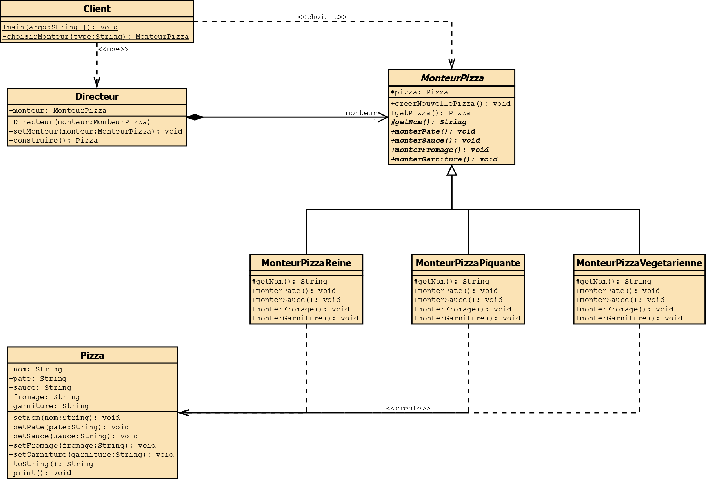

# Patron de construction : Builder / Monteur (INF461)

Devoir n°3 – Patrons de construction, cours INF461 *Principes et processus du logiciel*.

## Objectif du patron
Encapsuler la construction d'un **objet complexe** assemblé **partie par partie, dans un ordre précis**,
de sorte que le même processus de construction puisse produire des représentations différentes.

Participants : `Directeur` (ordre des étapes), `MonteurAbstrait` (une méthode par partie),
`MonteurConcret` (contenu de chaque partie), `Produit` (objet construit).

## Contenu

| Dossier | Contenu |
|---|---|
| `src/cours` | Exemple du cours : pizzas **Reine** et **Piquante** (pâte, sauce, garniture) |
| `src/modifie` | Exemple modifié : `Directeur` conforme au modèle générique (il détient le monteur et pilote `construire()`), nouvelle étape **fromage**, nouveau monteur **Végétarienne**, choix du monteur à l'exécution |
| `diagrammes` | Diagrammes de classes réalisés avec **Dia** (`.dia`) et leur export `.png` |



## Compilation et exécution (JDK 17)

```bash
javac -encoding UTF-8 -d out $(find src -name "*.java")
java -cp out cours.Client
java -cp out modifie.Client                 # les trois pizzas
java -cp out modifie.Client vegetarienne    # une pizza choisie à l'exécution
```

Sous PowerShell : `javac -encoding UTF-8 -d out (Get-ChildItem -Recurse src -Filter *.java).FullName`
