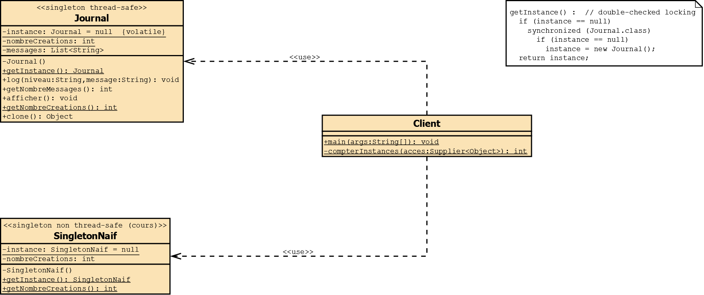

# Patron de construction : Singleton (INF461)

Devoir n°3 – Patrons de construction, cours INF461 *Principes et processus du logiciel*.

## Objectif du patron
Garantir qu'une classe ne possède **qu'une seule instance** et fournir un **point d'accès global** à celle-ci
(constructeur privé + attribut de classe + méthode de classe `getInstance()`).

## Contenu

| Dossier | Contenu |
|---|---|
| `src/cours/exemple1` | Exemple 1 du cours : structure générique (`Singleton`, `op1`, `op2`) |
| `src/cours/exemple2` | Exemple 2 du cours : `Singleton` avec `Somme`, `moyenne`, `Produit`, `affiche`, `clone` interdit |
| `src/modifie` | Exemple modifié : `Journal`, un journal d'application **thread-safe** (double-checked locking + `volatile`), comparé au singleton naïf du cours (`SingletonNaif`) |
| `diagrammes` | Diagrammes de classes réalisés avec **Dia** (`.dia`) et leur export `.png` |



## Compilation et exécution (JDK 17)

```bash
javac -encoding UTF-8 -d out $(find src -name "*.java")
java -cp out cours.exemple1.Main
java -cp out cours.exemple2.TestSingleton
java -cp out modifie.Client
```

Sous PowerShell : `javac -encoding UTF-8 -d out (Get-ChildItem -Recurse src -Filter *.java).FullName`

## Résultat de l'exemple modifié

```
=== 1) Singleton naïf (cours) accédé par 10 threads ===
Instances distinctes obtenues : 10 | constructeur appelé 10 fois

=== 2) Journal thread-safe accédé par 10 threads ===
Instances distinctes obtenues : 1 | constructeur appelé 1 fois
```

La version du cours n'est pas sûre en multi-thread : plusieurs threads peuvent passer le test
`instance == null` avant que l'un d'eux n'ait affecté l'instance. La version modifiée vérifie une
seconde fois sous verrou (`synchronized`) et déclare l'attribut `volatile`.
